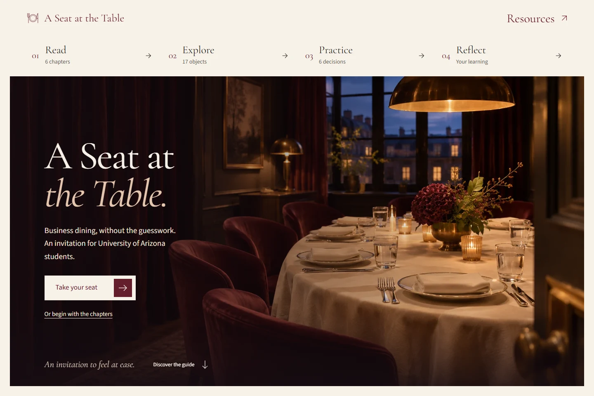
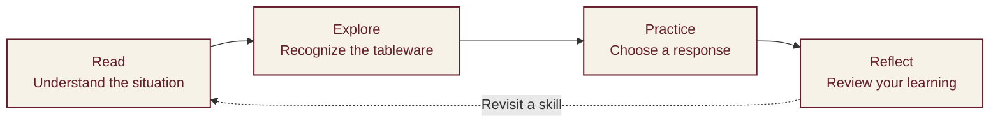
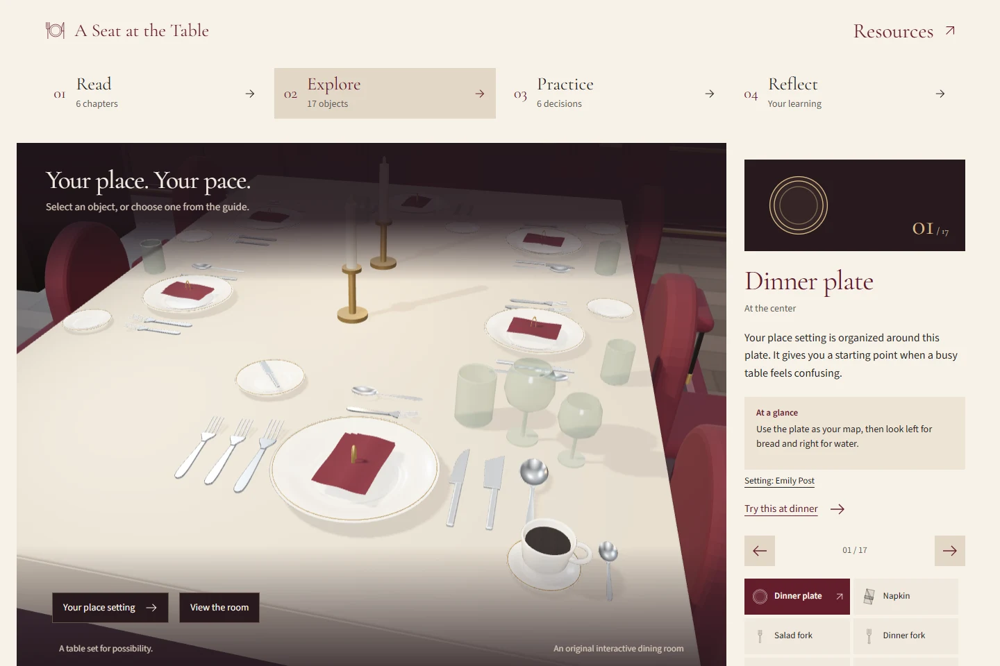
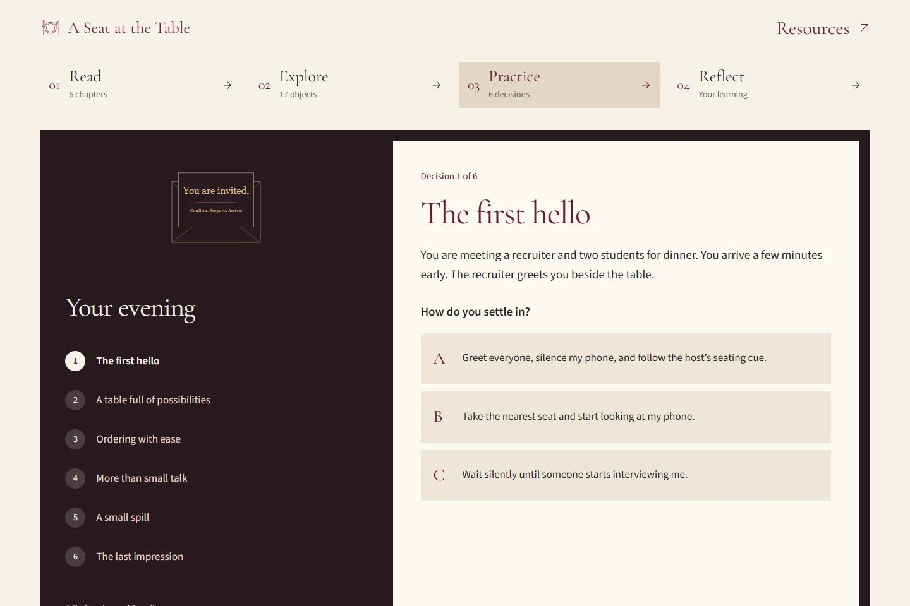
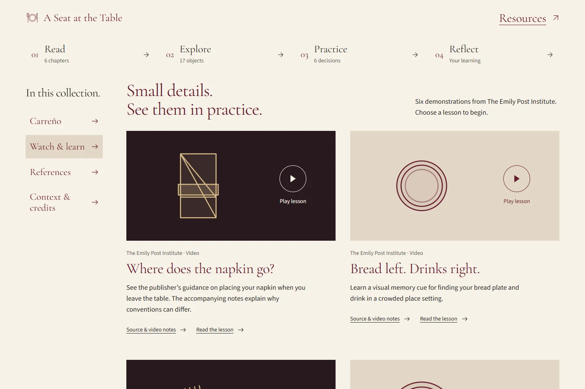

# A Seat at the Table

A business dining guide for University of Arizona students preparing for their first professional meal. Read the lessons, explore a place setting, rehearse a recruiting dinner, and reflect on what you learned.

**[Visit the website](https://a-seat-at-the-table-opal.vercel.app/)** · [Explore the table](https://a-seat-at-the-table-opal.vercel.app/table/) · [Try the dinner](https://a-seat-at-the-table-opal.vercel.app/practice/) · [View the submission PDF](docs/HW4_Submission_Omar_Quispe_Avalos.pdf)

[](https://a-seat-at-the-table-opal.vercel.app/)

An independent educational project by **Omar Quispe Avalos**, created for Homework #4, Business Dining Etiquette Website. The live site and this repository are public; visitors do not need to sign in.

## Follow the learning route

The four-stage navigation stays available throughout the learning pages. Follow the sequence or return directly to a skill you want to practice:

| Stage | What you do | Open the activity |
| --- | --- | --- |
| **01 Read** | Learn how to prepare, take your seat, read a setting, order, converse, and close the meal | [Six chapters](https://a-seat-at-the-table-opal.vercel.app/chapters/) |
| **02 Explore** | Select tableware to understand its position, purpose, and use | [17-object dining room](https://a-seat-at-the-table-opal.vercel.app/table/) |
| **03 Practice** | Make six decisions during a fictional recruiting dinner and examine the consequences | [Dinner simulator](https://a-seat-at-the-table-opal.vercel.app/practice/) |
| **04 Reflect** | Check six knowledge answers, consider your confidence, and choose your next learning goal | [Ten learning questions](https://a-seat-at-the-table-opal.vercel.app/reflection/) |



## Explore the learning activities

These screenshots show the published application, captured on November 11, 2026.

| The interactive table | The dinner rehearsal |
| --- | --- |
| [](https://a-seat-at-the-table-opal.vercel.app/table/) | [](https://a-seat-at-the-table-opal.vercel.app/practice/) |
| Connect each object's appearance and location with its purpose. | Consider the effect of a choice before facing the situation in person. |

### Find your way around the table

Select an object in the 3D scene or use its labeled control. The camera moves to that item, and the guide explains where it belongs, when to use it, and a habit to remember. Previous and next controls support a guided tour; the URL also identifies the selected object so you can return to it.

The expanded setting includes the following pieces:

- **Plate and linen**: dinner plate and napkin
- **Forks**: salad, fish, dinner, and dessert forks
- **Knives and spreader**: dinner knife, fish knife, and butter spreader
- **Spoons**: soup spoon, dessert spoon, and teaspoon
- **Other service pieces**: bread plate, water glass, red-wine glass, white-wine glass, and cup with saucer

The scene compares several courses together. An actual meal uses the pieces its menu requires; dessert and coffee service may arrive later. Alcohol is optional.

If WebGL is unavailable, a vector-rendered 3D room offers an alternative. You can also choose the labeled 2D map. Both alternatives share the same 17 objects and explanations. Keyboard input and reduced-motion preferences skip animated camera travel.

### Rehearse a professional dinner

The simulator places you at a meal with a recruiter and two students. Its six situations cover arrival, utensils, ordering with dietary needs, inclusive conversation, a spill, and the bill at an explicitly hosted meal.

Each situation presents three responses. After choosing, read the narrative consequence and the explanation of the recommended approach. Related chapter links let you review the skill in context. The final summary shows your results, and replay lets you reconsider the decisions.

### Check what you learned

The reflection page contains ten published questions:

- **Six knowledge questions** with three choices each, explained corrections, and related reading
- **Two optional confidence questions** about navigating a setting and joining a dining conversation
- **Two optional open reflections** about what you will use and what you want to learn next

Complete all six knowledge questions before checking your understanding. Missing-answer messages identify the questions still needing a response. Confidence and reflection answers are not graded.

Answers exist only in the current page's memory. They are not sent to a server, saved between visits, or shared with an instructor. Clear the answers or reload the page to start again.

## Read the sources and watch the demonstrations

[](https://a-seat-at-the-table-opal.vercel.app/resources/)

[Resources](https://a-seat-at-the-table-opal.vercel.app/resources/) brings together the historical foundation, six video demonstrations, contemporary reading, and design credits. The section index keeps those groups within reach while browsing.

Manuel Antonio Carreño's *Compendio del manual de urbanidad y buenas maneras* supplies the historical foundation. Citations identify chapters, articles, and paragraphs in the [Biblioteca Nacional de Colombia's 2016 digital edition](https://siise.bibliotecanacional.gov.co/BBCC/Documents/View/212). The site contextualizes historical social hierarchies and gender expectations rather than adopting them as current rules.

The Emily Post Institute and university career services support contemporary place settings and professional dining guidance. Each chapter distinguishes these sources from Carreño's principles. The lessons recognize cultural differences, dietary needs, and personal circumstances.

The six Emily Post videos cover napkins, bread and drinks, outside-in utensil order, seating, Continental technique, and basic table placement. Players load when you select a lesson. Each video offers a publisher citation, a direct YouTube alternative, and related written reading.

## Understand the implementation

Astro builds static HTML pages for the chapters and supporting content. React adds the table, simulator, and questionnaire. The application needs no backend or API key to run.

| Layer | Implementation and purpose |
| --- | --- |
| Pages and content | Astro and Markdown generate 14 documents, including six chapters and a custom 404 |
| Interactive activities | React and TypeScript manage selections, decisions, validation, and page-local answers |
| Dining room | Three.js uses original geometry, with WebGL and vector rendering paths |
| Motion | GSAP coordinates camera movement and activity feedback; reduced-motion preferences are respected |
| Visual system | Custom CSS, locally hosted Cormorant Garamond and Source Sans 3, and optimized WebP images |
| Hosting | Vercel serves the static `dist` output using the pinned Node 24.x build environment |

The 3D engine loads on the home and table pages; rendering runs on demand. Images reserve their dimensions, and video embeds wait for a selection. Actions become available after their event handlers are attached, protecting the first click while scripts load.

Written lessons, reference material, and the ten questions remain readable without JavaScript. Using the interactive scene, entering survey answers, and receiving automatic feedback requires JavaScript.

## Run the project locally

Install **Node.js 24.x** and npm. Clone the repository and install its locked dependencies:

```sh
git clone https://github.com/uainalaia/a-seat-at-the-table.git
cd a-seat-at-the-table
npm ci
npm run dev
```

Open the local address printed by Astro, normally `http://127.0.0.1:4321/`. No environment secrets are required. `.env.example` contains the optional Astro telemetry setting.

### Build and check the release

Run the type check, static build, and content checks:

```sh
npm run build
npm test
npm run preview
```

Leave the preview running. In another terminal, run the browser suite:

```sh
npm run test:browser
```

The suite uses an installed Microsoft Edge browser by default. For installed Chrome, set `PLAYWRIGHT_CHANNEL=chrome`. To test another origin in PowerShell:

```powershell
$env:TEST_BASE_URL='http://127.0.0.1:4321'
npm run test:browser
```

`PLAYWRIGHT_EXECUTABLE_PATH` selects an installed Chromium-based browser by its executable path. The tests do not publish the website. Use a local preview or an approved deployment when running checks against another origin.

### Find the relevant files

```text
src/
  content/chapters/   Six Markdown lessons
  components/        Navigation and learning activities
  data/              Questions, scenarios, tableware, and citations
  lib/               Rendering, motion, and validation logic
  pages/             Static routes
  styles/            Editorial and responsive styles
public/              Optimized images, diagrams, and licenses
assets/              Original artwork and provenance
tests/               Browser and content checks
docs/                Screenshots and the completed submission PDF
```

See [DESIGN.md](DESIGN.md) for the design context, [AUDIT-RELEASE.md](AUDIT-RELEASE.md) for the release evidence, and [DEPLOYMENT.md](DEPLOYMENT.md) for the existing Vercel deployment. Earlier review files record previous iterations.

## Review the assignment evidence

The [completed submission PDF](docs/HW4_Submission_Omar_Quispe_Avalos.pdf) contains the instructor's form, a review guide, all ten questions, and source references.

<details>
<summary>Open the rubric checklist</summary>

| Criterion | Points | Evidence in the project |
| --- | ---: | --- |
| Internal link | 10 | Links between chapters, activities, feedback, and resources |
| External link | 10 | Carreño's digitized edition, etiquette publishers, and university sources |
| Graphic element | 10 | Original 3D room, 17-object setting, SVG map, and chapter illustrations |
| Advanced feature | 20 | Six-decision simulator, selectable table, feedback, and embedded videos |
| Basic website design | 30 | Responsive layouts, readable typography, persistent navigation, and keyboard controls |
| References | 5 | Contextual citations, annotated bibliography, and image credits |
| Spelling and grammar | 5 | English lessons and activity explanations |
| General style | 10 | Consistent ivory, burgundy, and charcoal editorial identity |
| Published survey | Required | Six knowledge, two confidence, and two open questions |
| Submission form | Required | Completed PDF and the website's printable `/submission/` route |

This checklist identifies evidence; the instructor determines the grade.

</details>

The November 9 release audit records 41 local checks passed: 38 browser cases and three content checks. Anonymous production checks covered 13 routes, with activity tests in Edge and Brave. These records describe that release, not a new full test run for this documentation update.

Automated accessibility checks do not certify complete WCAG compliance. Screen-reader use, physical devices, other browser engines, native zoom, and a full caption review remain manual checks. The [release audit](AUDIT-RELEASE.md) explains those limits and external-source access restrictions.

## Credits and image provenance

The dining-room geometry, tableware, instructional diagrams, and chapter studies were created for this project. The opening image is an AI-generated illustration of a fictional salon; it does not depict a University of Arizona event. README screenshots are captures of the actual published site.

See [Resources and credits](https://a-seat-at-the-table-opal.vercel.app/resources/#resource-context), [artwork provenance](assets/editorial/ASSETS.md), and [font and Three.js licenses](public/licenses/). This independent project is not an official University of Arizona publication.
